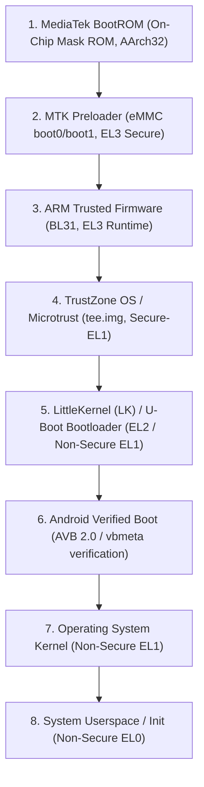

# Xiaomi Redmi 9 Hardware Platform & Boot-Chain Research Study

## 1. Executive Summary
- **Target Device**: Xiaomi Redmi 9
- **Platform / SoC**: MediaTek Helio G80 (MT6769V/CU or MT6769T)
- **CPU Cluster**: Octa-core ARM64 (2x ARM Cortex-A75 @ 2.0 GHz + 6x ARM Cortex-A55 @ 1.8 GHz)
- **GPU**: ARM Mali-G52 2EEMC2 (Valhall / Bifrost architecture)
- **Display**: 6.53-inch FHD+ (2340 x 1080) IPS LCD connected via MIPI DSI
- **Touch IC**: Goodix GT9886 or FocalTech FT8719 (varies by production batch)
- **Internal Storage**: eMMC 5.1 (32GB / 64GB / 128GB)
- **Power Management**: MediaTek MT6358 PMIC

---

## 2. Boot Chain Architecture & Security Stages

### Critical Security Boundaries:
1. **BootROM SLA/DAA**: MediaTek BootROM enforces Serial Link Authentication (SLA) and Download Agent Authentication (DAA). Without valid vendor cryptographic keys or specific BootROM exploit payloads (e.g., `kamakiri` / `amigo` bypass), direct low-level USB flashing is rejected.
2. **AVB 2.0 (Android Verified Boot)**: The stock LittleKernel (LK) verifies RSA-4096 / SHA-256 signatures in `vbmeta.img`. Flashing an unsigned kernel without unlocking the bootloader triggers `dm-verity` corruption (`Red State: Your device has failed verification`).
3. **Hardware Keystore & RPMB**: Replay Protected Memory Block (RPMB) on the eMMC chip stores hardware rollback indices. Flashing older firmware or modifying security states can trigger anti-rollback protection (ARB).

---

## 3. Strict Safety Protocol: Unchangeable Partitions

> [!CAUTION]
> The following partitions on the physical Redmi 9 contain unique, factory-calibrated hardware data. They must NEVER be erased, formatted, or written to:
> - `nvram` & `nvdata`: Baseband radio configuration, network calibration, IMEI, and MAC addresses. Loss of these causes permanent loss of cellular and Wi-Fi functionality.
> - `protect_f` & `protect_s`: Carrier parameters, modem security tokens.
> - `proinfo`: Serial numbers, hardware configuration flags.
> - `boot0` & `boot1`: Hardware hardware partitions housing the primary preloader binary.

---

## 4. Minimum Facts Required from the Physical Handset

Before any installation strategy can even be drafted for the real Redmi 9, the following verified facts must be retrieved non-destructively:

| Parameter | Method to Query | Purpose |
| :--- | :--- | :--- |
| **Board Codename** | `adb shell getprop ro.product.board` | Confirms whether device is `lancelot` (with NFC) or `galahad` (without NFC). |
| **Exact MIUI Version** | `adb shell getprop ro.build.version.incremental` | Determines preloader revision and anti-rollback (ARB) index. |
| **Display Panel Supplier** | `adb shell cat /proc/cmdline` or `dmesg \| grep -i dsi` | Detects whether panel is Tianma (`td4310`), Huaxing, or Shenchao. (Wrong driver = black screen). |
| **Touchscreen Controller** | `adb shell dumpsys input` or `dmesg \| grep -i touch` | Identifies Goodix vs Focaltech I2C touch IC. |
| **Bootloader State** | `fastboot getvar unlocked` | Confirms if hardware allows booting custom unsigned kernels. |
| **Partition Layout Table** | `adb shell cat /proc/partitions` | Verifies dynamic partition layout (`super` partition vs traditional A/B). |

---

## 5. Development Strategy
Until the above parameters are verified and a zero-risk testing harness (e.g. `fastboot boot <image>` memory-only boot without flashing) is established:
1. All kernel and userspace development is executed and tested in **QEMU**.
2. No write, flash, or erase commands will be issued to the physical phone.
